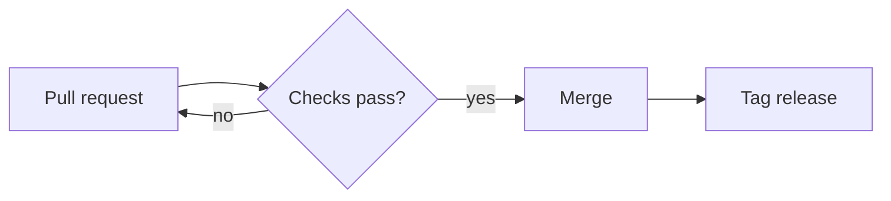
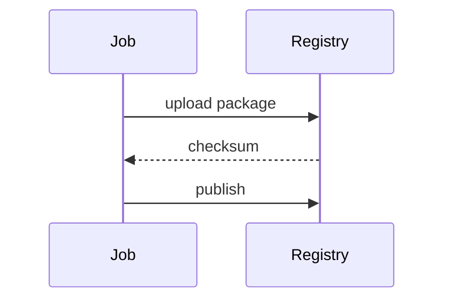
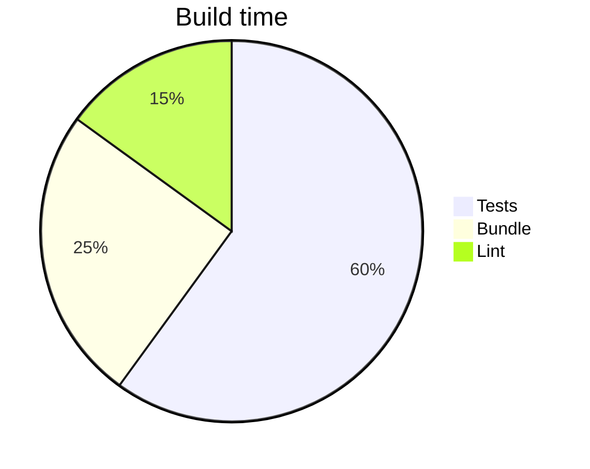

# Release flow

How a change reaches users.



The release job talks to the registry like this:



Where the time goes (pie charts stay as source):



Other code blocks are left alone:

```sh
npm test
```
